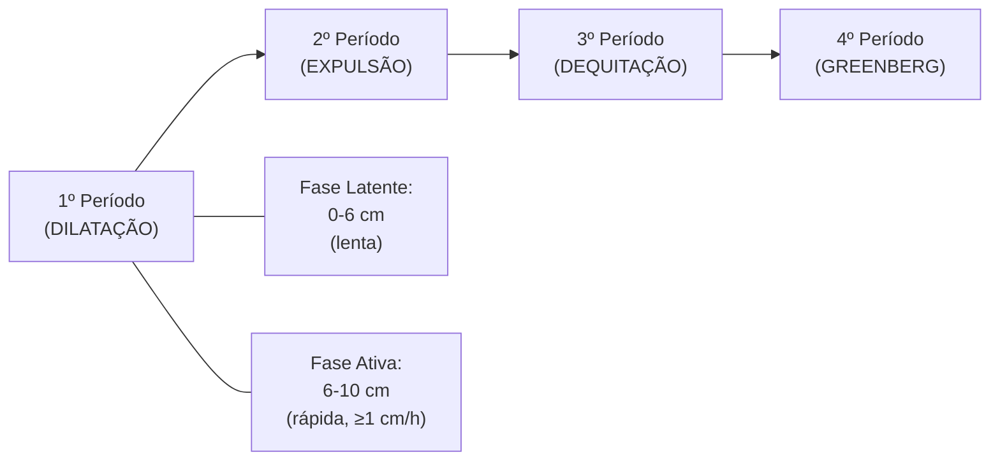
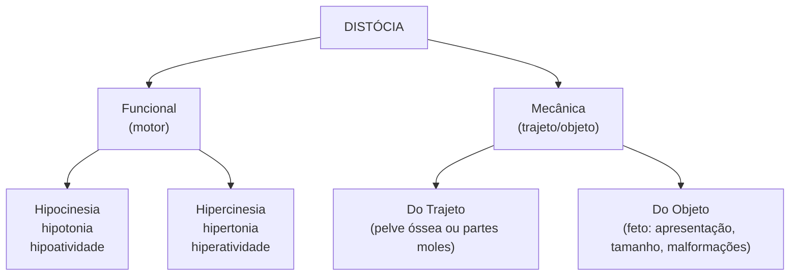
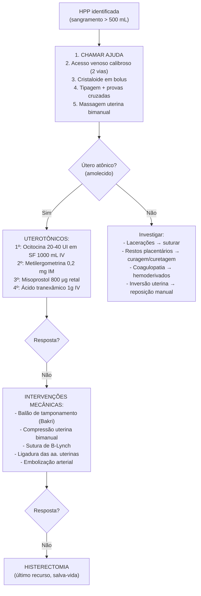
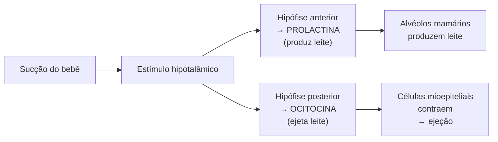

# 🏥 GUIA COMPLETO DE OBSTETRÍCIA E GINECOLOGIA
## Nível USMLE Step 2 CK / Step 2 CS / Step 3 + Ivy League
### Parte 2: Assistência ao Parto e Puerpério

---

## 📚 MÓDULO 12: TRABALHO DE PARTO

### 12.1 Conceito e Fisiologia

🎈 **Analogia**: O trabalho de parto é como abrir uma porta pesada de mola — o útero (a mola) contrai e empurra o bebê contra o colo (a porta). Cada contração empurra um pouco mais, e a porta vai abrindo devagar. Quando está totalmente aberta (10 cm), o bebê pode passar.

**Definição clínica**: Contrações uterinas regulares e progressivas que levam ao apagamento e dilatação do colo uterino, culminando na expulsão do concepto.

### 12.2 Diferenciação: Trabalho de Parto Verdadeiro vs. Falso (Braxton Hicks)

| Característica | Verdadeiro | Falso (Braxton Hicks) |
|---|---|---|
| **Regularidade** | Regular, intervalos decrescentes | Irregular |
| **Intensidade** | Progressivamente crescente | Sem progressão |
| **Localização** | Dorso → abdome anterior | Apenas abdome anterior |
| **Efeito da deambulação** | Mantém ou intensifica | Alivia |
| **Alteração cervical** | SIM (dilatação + apagamento) | NÃO |
| **Sedação** | NÃO cessa | Cessa com sedação |

### 12.3 As Fases do Trabalho de Parto

#### 1º Período — Dilatação (o mais longo):

| Subfase | Dilatação | Duração média | Características |
|---|---|---|---|
| **Fase Latente** | 0 → 6 cm | Nulípara: até 20h; Multípara: até 14h | Contrações a cada 5-10 min, irregulares, leve desconforto |
| **Fase Ativa** | 6 → 10 cm | Nulípara: ~6h; Multípara: ~3h | Contrações a cada 2-3 min, duração 45-60 seg, intensas |

🎈 **Analogia**: A fase latente é como aquecer o motor do carro — demora, mas é necessária. A fase ativa é quando o carro pega a estrada — anda rápido e não para.

> [!NOTE]
> **Definição atual (ACOG/Zhang, 2010)**: A fase ativa começa com **6 cm** (não mais 4 cm como na classificação de Friedman). Antes de 6 cm, a dilatação pode ser lenta sem indicar distocia. Isso é importante para evitar cesáreas desnecessárias.

#### 2º Período — Expulsão:
- Do **dilatação completa (10 cm)** até o **nascimento**
- Duração: nulípara até **3h** (com analgesia) ou **2h** (sem); multípara até **2h** (com) ou **1h** (sem)
- A gestante sente vontade de "fazer força" (reflexo de Ferguson)

#### 3º Período — Dequitação/Secundamento:
- Do nascimento até a **expulsão da placenta**
- Duração normal: até **30 minutos**
- Tipos de descolamento:
  - **Baudelocque-Schultze** (75%): face fetal primeiro, sangramento após → "mecanismo central"
  - **Baudelocque-Duncan** (25%): borda da placenta primeiro, sangramento durante → "mecanismo lateral"

#### 4º Período — Greenberg (1ª hora pós-parto):
- Período de observação rigorosa
- Risco de **hemorragia pós-parto**
- Monitorar: tônus uterino (deve ser contraído = "globo de segurança de Pinard"), sinais vitais, sangramento

### 12.4 Mecanismo do Parto — Os 7 Movimentos Cardinais

🎈 **Analogia**: O bebê precisa fazer uma "dança" para passar pelo canal de parto, que é como um túnel curvo. Ele vira a cabeça e o corpo de várias maneiras para encontrar o melhor "encaixe" — como passar uma chave em uma fechadura, girando até achar a posição certa.

| # | Movimento | O que acontece |
|---|---|---|
| 1 | **Insinuação (Encaixamento)** | A cabeça entra na pelve no diâmetro transverso ou oblíquo |
| 2 | **Descida** | A cabeça desce pelo canal de parto (pode ser simultânea) |
| 3 | **Flexão** | O queixo encosta no peito → apresenta o menor diâmetro (suboccipitobregmático = 9,5 cm) |
| 4 | **Rotação Interna** | O occipício gira de transverso para anterior (OA) → alinha com o diâmetro anteroposterior do estreito inferior |
| 5 | **Extensão** | A cabeça "desflexa" e emerge sob a sínfise púbica (occipício → face) |
| 6 | **Rotação Externa (Restituição)** | A cabeça gira de volta para alinhar com os ombros |
| 7 | **Expulsão** | Ombro anterior emerge sob a sínfise, depois o posterior, e o corpo desliza |

> [!TIP]
> **Mnemônico para USMLE**: "**E**very **D**ay **F**rank **I**nternal**ly** **E**xternally **E**xpels" → Engagement, Descent, Flexion, Internal rotation, Extension, External rotation, Expulsion

#### Estática Fetal — Termos Importantes:

| Conceito | Definição |
|---|---|
| **Situação** | Relação entre o maior eixo fetal e o materno: **Longitudinal** (vertical) ou **Transversa** |
| **Apresentação** | Parte fetal que se apresenta ao estreito superior: **Cefálica** (95%), Pélvica (3-4%), Córmica (transversa) |
| **Posição** | Relação do ponto de referência fetal com o lado materno: **esquerdo (E)** ou **direito (D)** |
| **Variedade de Posição** | Relação do ponto de referência com a pelve: **OEA** (occipito-esquerda-anterior = mais comum) |
| **Atitude** | Grau de flexão/deflexão da cabeça |

#### Apresentações Cefálicas por Grau de Deflexão:

| Apresentação | Ponto de Referência | Diâmetro | Tamanho | Viabilidade |
|---|---|---|---|---|
| **Fletida (Occipício)** | Lambda (fontanela posterior) | Suboccipitobregmático | 9,5 cm | ✅ Parto vaginal |
| **Defletida 1º grau (Bregma)** | Bregma (fontanela anterior) | Occipitofrontal | 12 cm | ⚠️ Difícil |
| **Defletida 2º grau (Fronte)** | Glabela/nariz | Occipitomentoniano | 13,5 cm | ❌ Inviável via vaginal |
| **Defletida 3º grau (Face)** | Mento (queixo) | Submentobregmático | 9,5 cm | ✅ Se mento anterior |

---

## 📚 MÓDULO 13: PARTOGRAMA

### 13.1 Conceito

🎈 **Analogia**: O partograma é como o "velocímetro" do parto. Ele mostra se o parto está andando na velocidade certa ou se está "travado". Se o tracinho do gráfico para de subir, é sinal de problema.

**Definição**: Registro gráfico do progresso do trabalho de parto (dilatação cervical x tempo), descida da apresentação e condições materno-fetais.

### 13.2 Estrutura do Partograma (OMS)

O partograma possui:
- **Eixo X**: tempo (horas)
- **Eixo Y**: dilatação cervical (cm) e descida da apresentação (planos de De Lee)
- **Linha de Alerta**: linha que marca o limite de progressão normal (1 cm/h a partir de 6 cm)
- **Linha de Ação**: paralela à linha de alerta, **4 horas** à direita → se a curva atingir esta linha, intervenção é necessária

### 13.3 Quando Iniciar o Preenchimento:
- A partir de **6 cm de dilatação** (início da fase ativa) — padrão OMS atual
- Registrar a cada **30-60 minutos**: dilatação, descida, FCF, PA materna, contrações, líquido amniótico

### 13.4 Interpretação — Padrões de Distocia:

| Padrão | Definição | Causa provável |
|---|---|---|
| **Parada de dilatação** | Sem progressão de dilatação por ≥ 4h com contrações adequadas (ou 6h sem contrações adequadas) | DCP, apresentação anômala |
| **Parada de descida** | Sem progressão da descida por ≥ 2-3h (com ou sem esforço expulsivo) | DCP, macrossomia |
| **Fase ativa prolongada** | Dilatação < 1 cm/h (curva cruza linha de alerta) | Distocia funcional, iatrogenia |

> [!IMPORTANT]
> **Para USMLE**: Antes de diagnosticar **parada de progressão**, é necessário confirmar:
> 1. Dilatação ≥ 6 cm
> 2. Membranas rotas
> 3. ≥ 4 horas com contrações adequadas (≥ 200 MVU) OU ≥ 6 horas com contrações inadequadas com ocitocina
> Só então considerar cesárea por falha de progressão.

---

## 📚 MÓDULO 14: ANALGESIA E ANESTESIA OBSTÉTRICA

### 14.1 Conceito

🎈 **Analogia**: A dor do parto é como subir uma montanha muito íngreme. A analgesia é como ter um "elevador" que tira a dor, mas mantém a mamãe acordada e capaz de participar.

### 14.2 Métodos Não Farmacológicos:
- Deambulação, banho quente (chuveiro/banheira), bola de parto
- Massagem, acupuntura, aromaterapia
- Técnicas de respiração e relaxamento
- Suporte contínuo (doula, acompanhante)

### 14.3 Métodos Farmacológicos:

| Método | Técnica | Vantagens | Desvantagens |
|---|---|---|---|
| **Peridural (Epidural)** | Cateter no espaço peridural (L3-L4 ou L4-L5) | Excelente analgesia, ajustável, mãe consciente | Hipotensão, retenção urinária, prolongar 2º período, cefaleia (se punção acidental da dura) |
| **Raquidiana (Subaracnóidea)** | Punção única no espaço subaracnóideo | Rápida, dose baixa | Duração limitada, cefaleia pós-punção |
| **Combinada (Raqui-Peri)** | Raquidiana + cateter peridural | Início rápido + possibilidade de manutenção | Maior complexidade técnica |
| **Opióides sistêmicos** | Meperidina, fentanil, remifentanil IV/IM | Fácil, acessível | Depressão respiratória neonatal, náusea, eficácia limitada |
| **Bloqueio do pudendo** | Infiltração do nervo pudendo (espinhas isquiáticas) | Bom para 2º período e episiotomia | Não alivia dor da contração |

> [!WARNING]
> **Contraindicações à analgesia neuroaxial**:
> - Recusa da paciente
> - Coagulopatia (plaquetas < 70.000-80.000)
> - Infecção no local de punção
> - Hipovolemia não corrigida
> - Pressão intracraniana elevada
> - Alergia aos anestésicos

### 14.4 Complicações da Analgesia Peridural:

| Complicação | Mecanismo | Conduta |
|---|---|---|
| **Hipotensão** | Bloqueio simpático → vasodilatação | Pré-hidratação, efedrina/fenilefrina, DLE |
| **Cefaleia pós-punção dural** | Fístula liquórica → hipotensão intracraniana | Hidratação, cafeína; se persistir → **blood patch** peridural |
| **Retenção urinária** | Bloqueio da inervação vesical | Cateterismo vesical |
| **Febre** | Mecanismo não completamente esclarecido | Monitorar; descartar infecção |
| **Bloqueio motor** | Dose excessiva de anestésico local | Reduzir concentração |

---

## 📚 MÓDULO 15: ASSISTÊNCIA AO PARTO HUMANIZADO

### 15.1 Princípios

🎈 **Analogia**: O parto humanizado é como deixar a natureza fazer seu trabalho, com respeito e carinho. Em vez de tratar o parto como uma "cirurgia", tratamos como um evento natural, intervindo apenas quando necessário.

### 15.2 Práticas Recomendadas (OMS 2018):

| ✅ RECOMENDADO | ❌ NÃO RECOMENDADO |
|---|---|
| Acompanhante de escolha da mulher | Enema (lavagem intestinal) |
| Liberdade de posição e deambulação | Tricotomia (raspagem dos pelos) |
| Oferta de líquidos e alimentação leve | Amniotomia de rotina |
| Métodos não farmacológicos de alívio da dor | Episiotomia de rotina |
| Contato pele a pele imediato | Kristeller (pressão no fundo uterino) |
| Clampeamento tardio do cordão (1-3 min) | Aspiração de rotina do RN |
| Respeitar o plano de parto | Separação mãe-bebê sem indicação |
| Monitoramento intermitente da FCF | Monitorização contínua de rotina (baixo risco) |
| Partograma | Ocitocina de rotina na fase ativa |

> [!CAUTION]
> A **Manobra de Kristeller** (pressão no fundo uterino durante o expulsivo) é **CONTRAINDICADA**. Associada a: rotura uterina, descolamento de placenta, lesão fetal, inversão uterina.

### 15.3 Episiotomia:
- **Não deve ser rotineira** (uso seletivo/restritivo)
- Indicação principal: sofrimento fetal agudo com necessidade de abreviar o expulsivo
- Tipos:
  - **Mediana** (midline): menor sangramento, melhor cicatrização, MAS maior risco de lesão do esfíncter anal (3º/4º grau)
  - **Médio-lateral**: maior sangramento, mais dolorosa, MAS menor risco de extensão para o esfíncter anal → **PREFERIDA**

### 15.4 Clampeamento do Cordão:
- **Tardio (1-3 minutos)**: RECOMENDADO pela OMS
  - Benefícios: ↑ reservas de ferro no RN, ↑ volume sanguíneo, ↓ anemia nos primeiros meses
  - Exceções: RN em asfixia grave necessitando reanimação imediata
- **Precoce (< 1 min)**: apenas em situações específicas

---

## 📚 MÓDULO 16: PARTO VAGINAL — ASSISTÊNCIA PRÁTICA

### 16.1 Monitorização Intraparto

**BCF (Batimentos Cardíacos Fetais):**
- Ausculta intermitente a cada **15-30 min** na fase ativa do 1º período
- Ausculta a cada **5 min** no 2º período (ou após cada contração)
- Normal: 110-160 bpm

**Contrações uterinas:**
- Palpar a cada 30-60 min
- Avaliar: frequência, duração, intensidade
- Fase ativa adequada: 3-5 contrações em 10 min, duração 40-60 seg

### 16.2 Assistência ao Período Expulsivo

**Posições de parto:**
- **Litotômica** (tradicional): mais usada em hospitais, permite melhor visualização
- **Semi-sentada** (45°): mais confortável, usa a gravidade
- **Lateral (Sims)**: boa para controle de velocidade
- **De cócoras**: usa gravidade, amplia diâmetros pélvicos
- **Quatro apoios**: boa para variedades posteriores

**Proteção perineal:**
- Técnica de "hands on" ou "hands poised" (mãos prontas sem pressão ativa)
- Controlar a velocidade de desprendimento da cabeça
- Manobra de **Ritgen modificada**: pressão controlada sobre o períneo para extensão controlada da cabeça

### 16.3 Distócias

🎈 **Analogia**: Distocia = parto "travado". É como uma peça de quebra-cabeça que não encaixa no lugar. Pode ser porque a peça é grande demais (bebê grande), o buraco é pequeno demais (pelve estreita), ou a força de empurrar não é suficiente (contrações fracas).

#### Classificação das Distócias:

#### Distócia Funcional (das contrações):

| Tipo | Problema | Conduta |
|---|---|---|
| **Hipoatividade uterina** | Contrações fracas/espaçadas | Amniotomia + ocitocina |
| **Hiperatividade uterina (taquissistolia)** | > 5 contrações em 10 min | Suspender ocitocina, tocolítico (terbutalina), DLE, O₂ |
| **Hipertonia uterina** | Tônus basal elevado, útero não relaxa | Suspender ocitocina, tocolítico |
| **Incoordenação uterina** | Contrações arrítmicas, sem progresso | Analgesia peridural ± ocitocina |

#### Distócia de Ombros — EMERGÊNCIA OBSTÉTRICA

🎈 **Analogia**: A cabeça do bebê nasceu, mas os ombros ficaram "presos" atrás do osso da mamãe (sínfise púbica). É como tentar tirar uma rolha de uma garrafa — a parte de cima saiu, mas o meio está preso.

**Definição**: Após o desprendimento da cabeça, há **necessidade de manobras adicionais** para liberar os ombros (além da tração suave e pressão no fundo)

**Mnemônico "HELPERR" para manobras:**

| Letra | Manobra | Descrição |
|---|---|---|
| **H** | Help (pedir ajuda) | Chamar equipe, anestesista, neonatologista |
| **E** | Evaluate for Episiotomy | Considerar episiotomia ampla (não resolve a distocia óssea, mas dá espaço) |
| **L** | Legs — **McRoberts** | Hiperflexão das coxas sobre o abdome (retifica o sacro, aumenta diâmetro AP) — **1ª manobra a ser feita** |
| **P** | Pressure — **Rubin I** | Pressão suprapúbica (NÃO fúndica!) para deslocar o ombro anterior |
| **E** | Enter — **Rubin II / Wood** | Rotação do ombro posterior para posição oblíqua |
| **R** | Remove posterior arm | Capturar e extrair o braço posterior |
| **R** | Roll — **Gaskin** | Colocar a paciente de quatro apoios (se possível) |

> [!CAUTION]
> **NUNCA fazer**:
> - Tração excessiva na cabeça → lesão do plexo braquial (paralisia de Erb-Duchenne: C5-C6)
> - Manobra de Kristeller → rotura uterina
> - Pressão **fúndica** → impacta mais o ombro

**Complicações da distócia de ombros:**

| Fetais | Maternas |
|---|---|
| Lesão do plexo braquial (Erb: C5-C6; Klumpke: C8-T1) | Hemorragia pós-parto |
| Fratura de clavícula | Lacerações perineais 3º/4º grau |
| Fratura de úmero | Rotura uterina |
| Asfixia neonatal | Lesão vesical/retal |
| Óbito | |

### 16.4 Parto Operatório (Fórceps e Vácuo-Extrator)

#### Indicações:
- Período expulsivo prolongado
- Exaustão materna
- Sofrimento fetal agudo no expulsivo
- Contraindicação ao esforço materno (cardiopatia, aneurisma cerebral)

#### Condições de aplicabilidade (todos devem estar presentes):

| Condição | Requisito |
|---|---|
| Dilatação | **Completa (10 cm)** |
| Membranas | **Rotas** |
| Apresentação | **Cefálica** |
| Encaixamento | **Insinuada** (≥ plano 0 de De Lee para fórceps médio; ≥ +2 para fórceps de alívio) |
| Proporcionalidade | **Sem DCP** |
| Bexiga | **Vazia** |
| Anestesia | **Adequada** |

### 16.5 Cesariana — Indicações

| Absolutas | Relativas |
|---|---|
| Placenta prévia centro-total | Macrossomia (> 4.500g em diabética, > 5.000g sem DM) |
| Desproporção cefalopélvica (DCP) verdadeira | Apresentação pélvica |
| Prolapso de cordão com feto vivo | Iteratividade (2+ cesáreas prévias) |
| Situação transversa | Gemelares monoamnióticos |
| Herpes genital ativo (lesões) | Falha de indução |
| Parada de progressão (após critérios adequados) | HIV com CV > 1.000 |
| Rotura uterina | |
| Sofrimento fetal agudo sem condições de parto vaginal imediato | |
| Vasa prévia | |

---

## 📚 MÓDULO 17: TERCEIRO PERÍODO E HEMORRAGIA PÓS-PARTO

### 17.1 Manejo Ativo do 3º Período (RECOMENDADO pela OMS)

🎈 **Analogia**: Depois que o bebê nasce, a placenta precisa sair. O "manejo ativo" é como ajudar gentilmente — damos um remédio para o útero contrair forte (ocitocina), fazemos uma tração controlada no cordão e massageamos o útero para garantir que ele fique "duro como uma bola" e pare de sangrar.

**As 3 etapas:**
1. **Ocitocina 10 UI IM** (ou 5 UI IV lenta) imediatamente após o nascimento
2. **Tração controlada do cordão** (manobra de Brandt-Andrews): uma mão traciona o cordão e a outra segura o útero acima da sínfise (contratração)
3. **Massagem uterina** após a dequitação

> [!IMPORTANT]
> O manejo ativo do 3º período **reduz em 60%** o risco de hemorragia pós-parto.

### 17.2 Hemorragia Pós-Parto (HPP)

**Definição**:
- **Parto vaginal**: perda sanguínea ≥ **500 mL** (ou ≥ 1.000 mL = HPP grave)
- **Cesárea**: perda sanguínea ≥ **1.000 mL**

**Incidência**: 5-10% dos partos → **principal causa de mortalidade materna no mundo**

#### Causas — Mnemônico dos "4 T's":

🎈 **Analogia**: Para lembrar por que a mamãe pode sangrar muito depois do parto, pense em 4 palavras com "T":

| T | Causa | Frequência | Detalhes |
|---|---|---|---|
| **Tônus** (Atonia uterina) | O útero não contrai | **70%** | O útero "cansado" não aperta os vasos → sangra |
| **Trauma** | Lacerações, hematomas, rotura uterina, inversão uterina | 20% | "Machucados" no canal de parto |
| **Tecido** (Restos placentários) | Placenta incompleta, acretismo | 9% | Pedaços da placenta que ficaram → útero não contrai |
| **Trombina** (Coagulopatia) | CIVD, coagulopatias, uso de anticoagulantes | 1% | O sangue não "coagula" direito |

#### Manejo da HPP — Abordagem Escalonada:

> [!WARNING]
> **Contraindicações da metilergometrina**:
> - **HAS/Pré-eclâmpsia** (risco de crise hipertensiva e AVC)
> - Usar misoprostol ou carbetocina como alternativa

#### Transfusão Maciça (se perda > 1.500 mL ou choque):
- Protocolo de transfusão maciça: **concentrado de hemácias : PFC : plaquetas = 1:1:1**
- **Ácido tranexâmico** 1g IV (dentro de 3h do início do sangramento) — reduz mortalidade (estudo WOMAN)

### 17.3 Acretismo Placentário

🎈 **Analogia**: Normalmente a placenta "gruda" no útero como um post-it — sai fácil. No acretismo, ela "gruda" como super cola — não sai, e tentar arrancar pode causar sangramento grave.

| Grau | Profundidade | Conduta |
|---|---|---|
| **Acreta** | Aderida ao miométrio superficial | Pode tentar remoção manual + curetagem |
| **Increta** | Invade o miométrio | Histerectomia geralmente necessária |
| **Percreta** | Atravessa o miométrio, pode atingir bexiga/intestino | Histerectomia + reparo de órgãos adjacentes |

**Fatores de risco**: cesáreas prévias + placenta prévia (principal), curetagens prévias, miomectomia

> [!CAUTION]
> **Placenta prévia + cesárea anterior** = alto risco de **percretismo**. USG com Doppler + RNM para planejamento cirúrgico. O parto deve ser planejado em centro terciário com banco de sangue preparado.

---

## 📚 MÓDULO 18: PUERPÉRIO FISIOLÓGICO

### 18.1 Conceito e Fases

🎈 **Analogia**: Depois que o bebê nasce, o corpo da mamãe precisa "voltar ao normal" — é como arrumar a casa depois de uma grande festa. O útero diminui, os hormônios mudam, e o leite começa a ser produzido.

| Fase | Período | Características |
|---|---|---|
| **Puerpério imediato** | 1º ao 10º dia | Involução uterina rápida, lóquios, apojadura (descida do leite) |
| **Puerpério tardio** | 11º ao 42º dia | Continuação da involução, cicatrização |
| **Puerpério remoto** | > 42 dias | Retorno da menstruação (se não amamentar), recuperação completa |

### 18.2 Involução Uterina

| Dia pós-parto | Altura do fundo uterino |
|---|---|
| Imediatamente | Cicatriz umbilical |
| 1º dia | 2 cm abaixo da cicatriz umbilical |
| 10-12 dias | Não palpável acima da sínfise |
| 6 semanas | Tamanho pré-gravídico |

### 18.3 Lóquios (Sangramento Pós-Parto Normal)

| Tipo | Cor | Período | Composição |
|---|---|---|---|
| **Rubros** (lochia rubra) | Vermelho-vivo | 1-3 dias | Sangue, tecido decidual |
| **Serosos** (lochia serosa) | Rosado/amarronzado | 4-10 dias | Soro, leucócitos |
| **Albos** (lochia alba) | Branco/amarelado | 11-42+ dias | Leucócitos, muco cervical |

> [!NOTE]
> Lóquios com **odor fétido** ou retorno de lóquios **rubros** após cessar → suspeitar de **endometrite** (infecção puerperal).

### 18.4 Retorno da Fertilidade

| Situação | Ovulação | Menstruação |
|---|---|---|
| **Não amamentando** | ~6-8 semanas | ~6-8 semanas |
| **Amamentação exclusiva** | Variável, pode ser > 6 meses | Variável |

> [!TIP]
> **LAM** (Lactational Amenorrhea Method): método contraceptivo se: amamentação exclusiva + amenorreia + < 6 meses pós-parto. Eficácia ~98%.

### 18.5 Contracepção no Puerpério

| Método | Quando iniciar | Observações |
|---|---|---|
| **DIU (cobre ou LNG)** | Imediato (pós-placenta) ou 4-6 sem | Seguro na amamentação |
| **Minipílula (progestágeno)** | 6 sem (ou imediato se não amamentar) | Compatível com amamentação |
| **Implante (etonogestrel)** | Imediato | Compatível com amamentação |
| **Injetável trimestral (medroxiprogesterona)** | 6 sem | Compatível com amamentação |
| **ACO combinado (estrogênio + progesterona)** | **NÃO** antes de 6 sem (ou 6 meses se amamentar) | Risco de TVP + reduz produção de leite |
| **Laqueadura tubária** | Intracesárea ou 6+ sem | Decisão informada, ≥ 25 anos ou ≥ 2 filhos (Brasil) |

---

## 📚 MÓDULO 19: ALEITAMENTO MATERNO

### 19.1 Importância

🎈 **Analogia**: O leite materno é como um "superpoder" — é o alimento perfeito feito sob medida para o bebê. É como se a mamãe tivesse uma "fábrica" que produz comida com anticorpos, vitaminas, e tudo que o bebê precisa. Nenhuma fórmula consegue copiar tudo isso.

### 19.2 Tipos de Aleitamento (OMS):

| Tipo | Definição |
|---|---|
| **Exclusivo** | Apenas leite materno (pode incluir medicamentos/vitaminas) — recomendado até **6 meses** |
| **Predominante** | Leite materno + água/chás/sucos |
| **Complementado** | Leite materno + alimentos sólidos/semissólidos — dos **6 meses aos 2 anos ou mais** |
| **Misto/Parcial** | Leite materno + fórmula/outros leites |

### 19.3 Fisiologia da Lactação

🎈 **Analogia**: A **prolactina** é o "cozinheiro" que faz o leite. A **ocitocina** é o "garçom" que serve o leite ao bebê. Quanto mais o bebê suga, mais o cozinheiro e o garçom trabalham.

### 19.4 Composição do Leite Materno

| Tipo | Quando | Características |
|---|---|---|
| **Colostro** | Primeiros 3-5 dias | Amarelado, rico em **IgA secretora**, proteínas, leucócitos. Volume pequeno (suficiente!) |
| **Leite de transição** | 5-14 dias | Aumenta volume, muda composição |
| **Leite maduro** | > 14 dias | Maior teor de gordura e lactose, volume pleno |

### 19.5 Técnica de Amamentação — Pega Correta

| Critério de pega correta | Descrição |
|---|---|
| **Boca bem aberta** | > 120° |
| **Lábio inferior evertido** | "Boca de peixe" |
| **Aréola mais visível acima** | Mais aréola acima da boca do que abaixo |
| **Queixo tocando a mama** | Contato próximo |
| **Bochechas arredondadas** | Sem covinha (covinha = pega errada, vácuo inadequado) |
| **Sucção audível** | Deglutição ouvida, sem estalos |

### 19.6 Problemas Comuns da Amamentação

| Problema | Causa | Conduta |
|---|---|---|
| **Fissuras mamilares** | Pega incorreta | Corrigir pega, leite materno no mamilo, lanolina |
| **Ingurgitamento** | Estase láctea | Esvaziar mamas (ordenha manual), compressas mornas antes e frias após, mamadas frequentes |
| **Mastite** | Infecção bacteriana (S. aureus) | ATB (cefalexina/dicloxacilina) + manter amamentação + analgesia + esvaziamento |
| **Abscesso mamário** | Complicação da mastite | Drenagem cirúrgica + ATB. Amamentar na mama contralateral; na ipsilateral se incisão longe da aréola |
| **Candidíase mamária** | Candida albicans | Nistatina/miconazol tópico na mama + tratar bebê |
| **Baixa produção** | Pega incorreta, frequência insuficiente, estresse | Livre demanda, técnica correta, hidratação, suporte emocional |

> [!IMPORTANT]
> **A mastite NÃO é contraindicação para amamentação!** Pelo contrário, manter a amamentação ajuda no esvaziamento e na resolução. Suspender apenas se abscesso com drenagem próxima à aréola.

### 19.7 Contraindicações Absolutas à Amamentação

| Condição | Motivo |
|---|---|
| **HIV materno** (no Brasil) | Risco de transmissão vertical |
| **HTLV-1 ou HTLV-2** | Risco de transmissão |
| **Galactosemia do RN** | Incapacidade de metabolizar galactose |
| **Uso materno de drogas ilícitas** (cocaína, crack, anfetaminas) | Passam pelo leite |
| **Quimioterapia/radioterapia** | Citotóxicos no leite |
| **Tuberculose ativa não tratada** (suspender temporariamente) | Risco de transmissão respiratória; reiniciar após 2 sem de tratamento |

---

## 📚 MÓDULO 20: COMPLICAÇÕES PUERPERAIS

### 20.1 Infecção Puerperal (Endometrite)

🎈 **Analogia**: Depois do parto, o interior do útero é como uma "ferida aberta" onde a placenta estava grudada. Se bactérias entrarem, causam infecção — como quando um corte no joelho inflama.

**Definição**: Febre ≥ 38°C em ≥ 2 medidas com intervalo de 4h, a partir de **24h pós-parto** (excluir as primeiras 24h, pois febre pode ser fisiológica)

**Fatores de risco**:
- **Cesárea** (principal fator de risco — 5-10x maior que parto vaginal)
- RPMO prolongada
- Trabalho de parto prolongado
- Múltiplos toques vaginais
- Corioamnionite
- Retenção de restos placentários

**Etiologia**: Polimicrobiana (E. coli, estreptococos, anaeróbios, Gardnerella)

**Quadro clínico**: Febre, dor à palpação uterina, lóquios fétidos/purulentos, útero subinvoluído, taquicardia

**Tratamento**: **Clindamicina 900 mg IV 8/8h + Gentamicina 5 mg/kg/dia IV** (esquema "gold standard" para endometrite pós-cesárea)
- Se não melhorar em 48-72h → considerar abscesso pélvico, tromboflebite pélvica séptica, ou ampliar espectro com ampicilina (cobrir Enterococcus)

### 20.2 Tromboembolismo Venoso (TVP/TEP)

**Fatores de risco no puerpério**:
- Cesárea (especialmente de emergência)
- Imobilização
- Obesidade
- Pré-eclâmpsia
- Hemorragia com transfusão
- Trombofilias

**Diagnóstico**:
- **TVP**: dor + edema unilateral em MMII → USG Doppler venoso
- **TEP**: dispneia súbita + taquicardia + dor torácica pleurítica → angio-TC de tórax

**Tratamento**: Anticoagulação com **heparina (não fracionada ou HBPM)** → seguras na amamentação

**Profilaxia**: HBPM (enoxaparina 40 mg SC/dia) em pacientes de risco por 6 semanas pós-parto

### 20.3 Depressão Pós-Parto

🎈 **Analogia**: Muitas mamães ficam tristes nos primeiros dias após o parto — isso se chama "baby blues" e é normal (afeta 50-80%). Mas se essa tristeza fica muito forte, dura mais de 2 semanas e impede a mamãe de cuidar do bebê, é depressão pós-parto — precisa de ajuda profissional.

| Condição | Início | Duração | Gravidade | Conduta |
|---|---|---|---|---|
| **Baby blues** | 2-3 dias | Até 2 semanas | Leve (choro, irritabilidade, ansiedade) | Suporte, reassegurar |
| **Depressão pós-parto** | 2 sem - 12 meses | Semanas-meses | Moderada-grave (tristeza profunda, anedonia, culpa, insônia, pensamentos de morte) | Psicoterapia + antidepressivos (ISRS: sertralina é segura na amamentação) |
| **Psicose puerperal** | Primeiras 2 semanas | Variável | Grave (delírios, alucinações, agitação, risco de infanticídio/suicídio) | **EMERGÊNCIA**: internação psiquiátrica + antipsicóticos + estabilizadores de humor |

> [!CAUTION]
> **Psicose puerperal** é uma **emergência psiquiátrica**. Risco de infanticídio e suicídio. Ocorre em 1-2/1.000 partos, mais comum em transtorno bipolar. Nunca deixar a mãe sozinha com o bebê até estabilização.

**Rastreio**: Escala de Depressão Pós-Parto de Edinburgh (EPDS) — aplicar em todas as puérperas. Score ≥ 13 → rastrear ativamente

### 20.4 Outras Complicações Puerperais

| Complicação | Características | Conduta |
|---|---|---|
| **Subinvolução uterina** | Útero maior que o esperado, sangramento prolongado | Investigar restos placentários (USG), uterotônicos |
| **Deiscência de episiotomia/cesárea** | Abertura da sutura, dor, secreção | Limpeza, ATB, ressutura (se necessário) |
| **Hematoma de parede/vulvar** | Dor intensa, massa palpável | Drenagem cirúrgica se volumoso |
| **Síndrome de Sheehan** | Necrose hipofisária por hemorragia grave → agalactia, amenorreia, hipotireoidismo, insuficiência adrenal | Reposição hormonal |
| **Inversão uterina** | Fundo uterino se invagina → choque + massa na vagina | Reposição manual (manobra de Johnson) + uterotônicos depois |
| **Retenção urinária** | Frequente após peridural | Cateterismo vesical |

> [!NOTE]
> **Síndrome de Sheehan**: "A mamãe que sangrou muito no parto e depois o leite não desceu, a menstruação não voltou, e ela sente muito cansaço." → necrose da hipófise anterior. O 1º sinal geralmente é **agalactia** (não produz leite).

---

## 📋 HIGH-YIELD REVIEW — MÓDULO PARTO E PUERPÉRIO

> [!IMPORTANT]
> ### ⭐ Top 20 High-Yield Points para USMLE
>
> 1. **Fase ativa**: começa com **6 cm** (critério atual ACOG), não mais 4 cm.
> 2. **Parada de progressão**: ≥ 6 cm + membranas rotas + 4h contrações adequadas (ou 6h sem).
> 3. **Desaceleração tardia** = insuficiência uteroplacentária; **variável** = compressão de cordão.
> 4. **Manobra de McRoberts** = 1ª manobra na distócia de ombros (hiperflexão das coxas).
> 5. **HPP**: causa mais comum = **atonia uterina** (70%).
> 6. **4 T's** da HPP: Tônus, Trauma, Tecido, Trombina.
> 7. **Ácido tranexâmico**: 1g IV em ≤ 3h → reduz mortalidade na HPP (WOMAN trial).
> 8. **Manejo ativo do 3º período**: ocitocina + tração controlada + massagem uterina.
> 9. **Ocitocina**: contraindicada em hipertonia uterina e taquissistolia.
> 10. **Metilergometrina**: contraindicada na **hipertensão**.
> 11. **GBS**: profilaxia com penicilina G IV ≥ 4h antes do parto.
> 12. **Episiotomia médio-lateral**: preferida (menor risco de extensão até esfíncter anal).
> 13. **Clampeamento tardio** (1-3 min): recomendado pela OMS.
> 14. **Endometrite**: cesárea é o principal fator de risco. Tto: clindamicina + gentamicina IV.
> 15. **TEP no puerpério**: heparina é segura na amamentação. Warfarina também.
> 16. **Baby blues**: normal, até 2 sem. **Depressão pós-parto**: > 2 sem, precisa de tratamento.
> 17. **Psicose puerperal**: emergência! Risco de infanticídio. Internação imediata.
> 18. **Síndrome de Sheehan**: panhipopituitarismo pós-HPP grave. 1º sinal: agalactia.
> 19. **Prolactina produz, ocitocina ejeta** leite. Sucção é o principal estímulo.
> 20. **Mastite**: NÃO parar de amamentar! ATB + esvaziar mama + analgesia.
